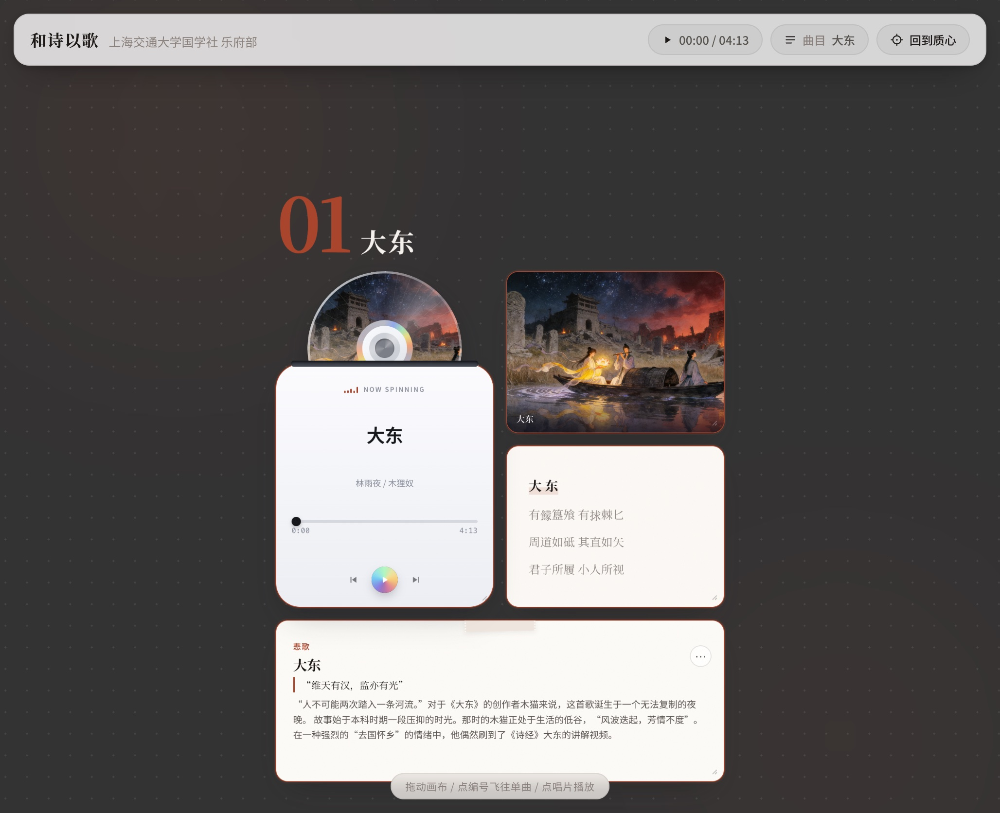

# 和诗以歌 · 数字黑胶画布

上海交通大学国学社乐府部《和诗以歌》专辑的浏览实验。六首歌各占一组 cluster，在无限画布上由章节牌、唱机、插画、歌词和手记组成；另有一份可复用的组件库。

线上：<https://muvas.sjtuguoxue.space>



## 页面

| 路径 | 内容 |
| --- | --- |
| `/` | 画布 demo（`demo.html`，由 `vercel.json` 重写） |
| `/ui.html` | UI 组件库：卡片、章节牌、唱机、手记、插画、歌词 |
| `/slot-cd.html` | slot-cd 唱机视觉参考页 |
| `/demo.original.html` | 最初的黑胶 demo，保留作对照 |

## 组件

- `components.css` 是唯一的组件样式表，`demo.html` 与 `ui.html` 共用。
- 每个组件四档：`sz-1x1`、`sz-1x2`、`sz-2x1`、`sz-2x2`。
- 画布默认每组：章节牌 `2x1` 在上，左侧 `1x2` 唱机，右侧上 `1x1` 插画、下 `1x1` 歌词，底部 `2x1` 手记；组间留 4 行 × 4 列空白。
- 主题色由每首歌的 `--cluster-accent` 指定，没有全局默认强调色。

## 本地

直接打开 `demo.html` 即可（音频使用离线能量包络）；也可以起一个静态服务器，让 Web Audio 分析器生效：

```bash
python3 -m http.server 8000
# http://localhost:8000/demo.html
```

## 部署

纯静态站点，Vercel 直接识别。`vercel.json` 把 `/` 重写到 `/demo.html`；其余页面与 `assets/` 按路径直出。自定义域名在 Vercel 中添加，DNS 使用 `cname-china-hosted.vercel-dns.com`，证书由 Vercel 自动签发。

## 内容

音乐、插画、文案与专辑视觉版权归上海交通大学国学社乐府部及各创作者所有，仅用于本项目的展示与归档。
